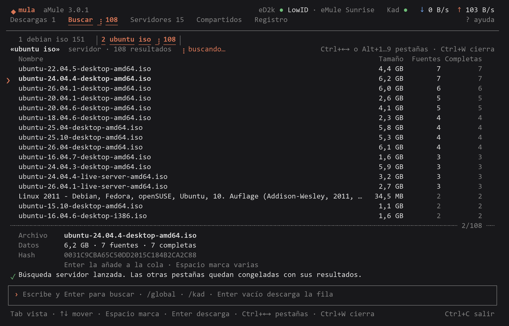
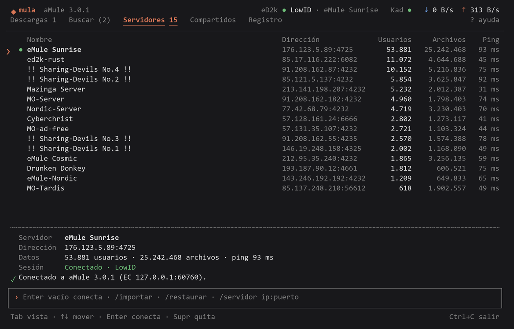
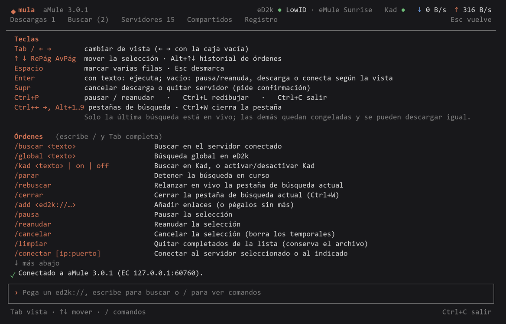

# mula

Consola para manejar el aMule de [aMule Modern](https://github.com/eduardoddddddd/amule-modern) desde una terminal, sobre todo por SSH, cuando no hay escritorio remoto. Interfaz a pantalla completa al estilo Claude Code: pestañas, tablas, una caja de entrada abajo y órdenes con `/` que se autocompletan.



Usa **el mismo motor y el mismo perfil** que aMule Modern: misma cola, mismos servidores (`server.met` y la copia `server-snapshot.txt`), mismas carpetas de descarga (`IncomingDir`/`TempDir` de su `amule.conf`). No guarda configuración propia salvo las pestañas de búsqueda.

## Capturas

| Servidores | Ayuda (`?`) |
|---|---|
|  |  |

## Uso

```powershell
ssh rogally          # y luego:
mula                 # interfaz
mula --iniciar       # arranca el motor si está parado, sin preguntar
mula estado          # resumen en texto
mula add "ed2k://|file|…|/"
mula iniciar | parar
```

En una sola línea: `ssh -t rogally mula` (hace falta `-t` para tener terminal).

Si el motor está parado, mula ofrece arrancarlo. Lo lanza por WMI para que **sobreviva al cerrar la sesión SSH** y restaura servidores y cola desde las copias de aMule Modern, igual que la propia app.

### Teclas

| Tecla | Acción |
|---|---|
| Tab / ← → (caja vacía) | cambiar de vista: Descargas, Buscar, Servidores, Compartidos, Registro |
| ↑ ↓ RePág AvPág | mover la selección |
| Espacio | marcar varias filas (Esc desmarca) |
| Enter (caja vacía) | pausa/reanuda, descarga el resultado o conecta al servidor, según la vista |
| Supr | cancelar descarga o quitar servidor (pide confirmación) |
| Ctrl+← → / Alt+1…9 | pestañas de búsqueda; Ctrl+W cierra la actual |
| ? | ayuda · Ctrl+C sale (el motor sigue) |

Texto sin barra: un `ed2k://` se añade a la cola; cualquier otra cosa busca. Escribe `/` para ver todas las órdenes: `/global`, `/kad`, `/rebuscar`, `/conectar`, `/restaurar`, `/importar`, `/limites`, `/carpetas`, `/motor`…

### Búsquedas en pestañas

amuled solo mantiene una búsqueda viva. Cada búsqueda nueva abre una pestaña y congela las anteriores con sus resultados; desde una pestaña congelada se puede descargar igual (mula usa el enlace ed2k con hash y tamaño). `/rebuscar` relanza la pestaña actual. Las pestañas se guardan en `%USERPROFILE%\.mula\searches.json` y siguen ahí en la siguiente sesión SSH.

## Convivencia con aMule Modern

- mula se engancha a cualquier `amuled` que escuche en el puerto EC del perfil, incluido el que lanza aMule Modern. Pueden estar los dos abiertos a la vez.
- Si el motor lo arrancó mula, aMule Modern no se engancha a él (avisa de puerto EC ocupado). Antes de abrir la app gráfica: `mula parar`.

## Instalar

```powershell
.\scripts\Install.ps1
```

Publica en `%USERPROFILE%\.mula\bin` y lo añade al PATH de usuario. Necesita el runtime de .NET 10. No se instala en AppData a propósito: una instalación hecha desde dentro de una app MSIX (por ejemplo, una sesión de Claude de escritorio) acaba en la copia privada de AppData de esa app, invisible para SSH. Por ese motivo, mula también busca el perfil de aMule Modern en `AppData\Local\Packages\*\LocalCache\Local\AmuleModern`.

Opciones: `--perfil <carpeta>`, `--motor <amuled.exe>`, o las variables `MULA_PROFILE` y `MULA_ENGINE`.

## Código

- `src/Amule`: cliente EC copiado de aMule Modern (sin cambios salvo `EcClientState.cs`).
- `src/Mula`: terminal ANSI propia (sin dependencias), motor, vistas y órdenes.
- Compilación Debug: `MULA_KEYS="/global dune{enter}{wait5}{c-left}"` reproduce teclas para probar la interfaz.

Licencia GPL-2.0-or-later, como aMule Modern.
